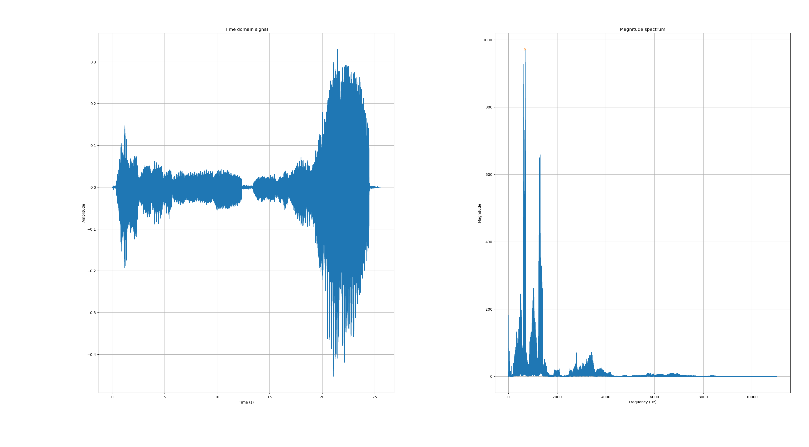
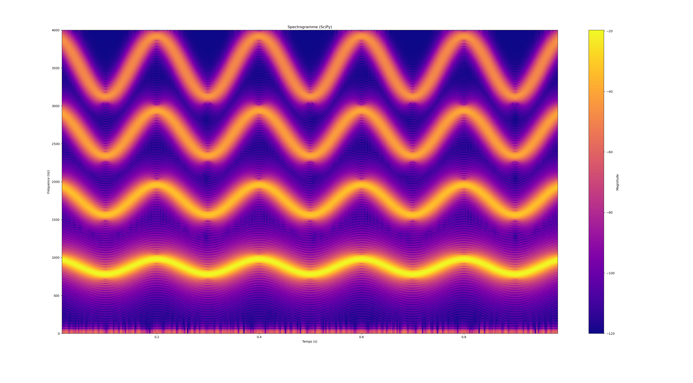
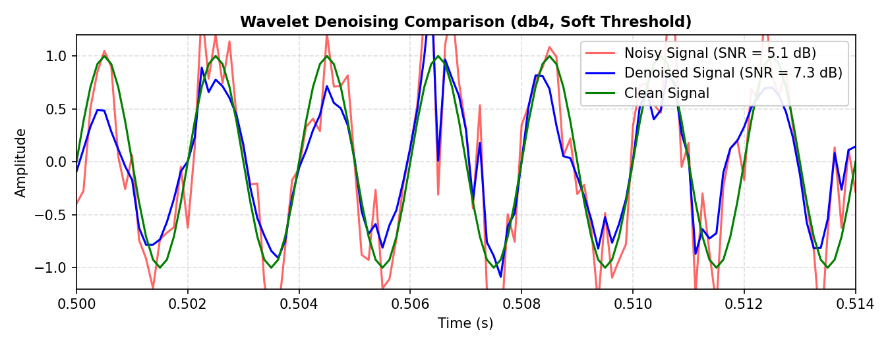
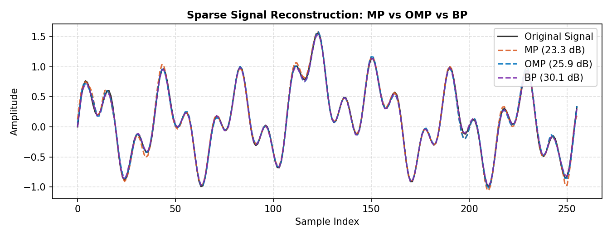

# Signal Processing Lab 2: Advanced Spectral Analysis

This project covers four core topics: **pitch detection**, **filter bank decomposition**, **wavelet denoising** and **source separation**, and **sparse audio compression** using pursuit algorithms.

---

## 1. Fundamental Frequency Detection (f0)

Estimation of fundamental frequency across audio frames on speech (`voiceP.wav`) and flute (`fluteircam.wav`), evaluated against ground truth.

- **Methods implemented:** Short-Time FFT, Autocorrelation, Levinson-Durbin LPC, Burg autoregressive estimation.
- **Features:** Silence energy thresholding, continuous note segmentation, and tempo tracking.

### Audio Samples

- **Voice:** [`voiceP.wav`](audios/voiceP.wav) — <a href="https://cdn.jsdelivr.net/gh/l33lou/signal-processing-lab2@main/audios/voiceP.wav" target="_blank">Play audio in new tab</a>
- **Flute:** [`fluteircam.wav`](audios/fluteircam.wav) — <a href="https://cdn.jsdelivr.net/gh/l33lou/signal-processing-lab2@main/audios/fluteircam.wav" target="_blank">Play audio in new tab</a>

### Visualization



*Figure 1: Frame-by-frame FFT spectrum and estimated fundamental frequency f0 on speech.*

---

## 2. Filter Banks and Subband Decomposition

Decomposition of a harmonic multi-tone signal into individual single-tone subbands using a dyadic filter cascade.

- **Signal:** Sum of four sine waves ($f_0 = 880\text{ Hz}$, $F_s = 8000\text{ Hz}$).
- **Analysis:** Dynamic filter branching, spectral transposition tracking, and frequency modulation (vibrato: $5\text{ Hz}$ rate, $20\text{ Hz}$ amplitude).

### Audio Sample

- **Harmonic signal with vibrato:** [`sig_harmonique_vibrato.wav`](audios/sig_harmonique_vibrato.wav) — <a href="https://cdn.jsdelivr.net/gh/l33lou/signal-processing-lab2@main/audios/sig_harmonique_vibrato.wav" target="_blank">Play audio in new tab</a>

### Visualization



*Figure 2: Time-frequency representation of the harmonic signal under vibrato modulation.*


## 3. Wavelet Denoising and Source Separation

Multiresolution analysis using Discrete Wavelet Transforms (DWT) for signal enhancement and underdetermined source separation.

- **Wavelet Denoising:** Multilevel decomposition (`db4`), soft/hard thresholding (Donoho universal threshold and Monte Carlo SNR optimization), and inverse reconstruction.
- **Source Separation:** Subband coefficient masking to separate two mixed frequencies ($100\text{ Hz}$ and $500\text{ Hz}$) from a single sensor.

### Visualization



*Figure 3: Wavelet denoising comparison showing clean, noisy (SNR = 7.9 dB), and reconstructed signal (SNR = 17.6 dB).*

---

## 4. Sparse Signal Compression (Pursuit Algorithms)

Audio signal compression by decomposing signals into sparse linear combinations over a redundant, overcomplete dictionary ($D \in \mathbb{R}^{N \times M}$):

$$y \approx D x \quad \text{with } \|x\|_0 \ll N$$

- **Dictionary composition:** Concatenation of orthogonal DCT basis, time-shifted multiscale Gabor atoms (Hanning windows), and multiscale Wavelet bases (`db4`, `sym4`).
- **Algorithms:**
  - **Matching Pursuit (MP):** Greedy correlation selection with non-orthogonal residual update.
  - **Orthogonal Matching Pursuit (OMP):** Greedy selection with orthogonal projection (Standard LS, QR, and Cholesky solvers).
  - **Basis Pursuit (BP / Lasso):** Convex $\ell_1$-regularization solved via FISTA (Fast Iterative Shrinkage-Thresholding Algorithm).
- **Metrics compared:** Signal-to-Noise Ratio (SNR in dB), runtime (seconds), and compression ratio ($\text{CR} = N / K$).

### Visualization



*Figure 4: Reconstruction of an audio frame using MP, OMP, and BP.*

---

## Project Structure

```text
signal-processing-lab2/
├── audios/                      # Audio recordings (.wav) and ground truth data
│   ├── fluteircam.wav
│   ├── sig_harmonique_vibrato.wav
│   └── voiceP.wav
├── code/                        # Execution scripts and modular algorithms
│   ├── frequency_detection.py   # Pitch detection pipeline
│   ├── filter_banks.py          # Cascaded filter bank decomposition
│   ├── wavelets_denoising.py    # DWT denoising experiments
│   ├── wavelets_source-separation.py # Wavelet source separation
│   ├── pursuit_compression.py   # MP, OMP, and BP compression benchmark
│   └── tools/                   # Signal processing helper libraries
│       ├── pursuit.py           # Dictionaries, MP, OMP, and BP solvers
│       ├── pursuit_visualisation.py
│       ├── denoising.py
│       ├── separation.py
│       ├── fft.py
│       └── autocorrelation.py
├── report/                      # Report images and LaTeX source files
│   └── images/
└── README.md
```

---

## Requirements and Execution

### Dependencies

```bash
pip install numpy scipy matplotlib PyWavelets
```

### Running Experiments

- **Pursuit audio compression benchmark:**
  ```bash
  python3 code/pursuit_compression.py
  ```

- **Wavelet denoising:**
  ```bash
  python3 code/wavelets_denoising.py
  ```

- **Wavelet source separation:**
  ```bash
  python3 code/wavelets_source-separation.py
  ```

- **Filter banks:**
  ```bash
  python3 code/filter_banks.py
  ```
